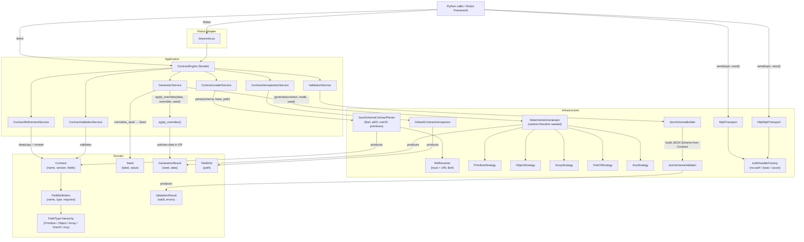

# Architecture

## Notes

- `ContractLoaderService` auto-detects Azure DevOps UI URLs and rewrites them to API URLs.
- `DeterministicGenerator` uses a strategy map keyed by `type(field_type)` — adding a new `FieldType` requires registering a strategy there.
- `GeneratorService` calls `apply_overrides` after generation, passing the `Seed` so override values can embed `{SEED}` as a placeholder.
- `ValidationService` rebuilds the JSON Schema from the domain `Contract` on every call via `JsonSchemaBuilder` — no caching.
