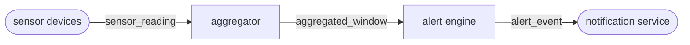
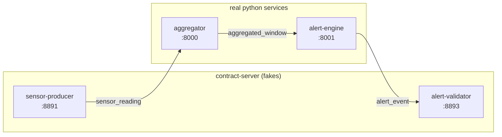
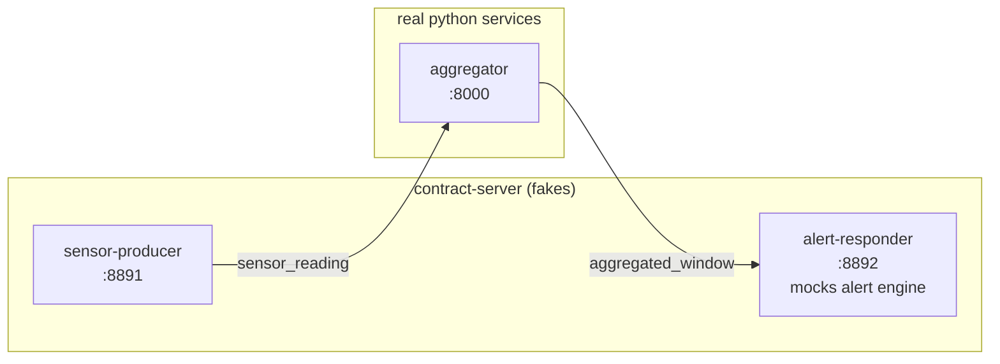

# Architecture

Two views: **production** — what a real deployment would look like, and **demo** — how contract-server mocks and validators wire into the same chain to exercise it end to end.

## Contracts

Three JSON Schema contracts define the payloads between stages, plus one small ack:

- `sensor_reading.json` — a single measurement (air_quality, climate, or noise) from a sensor
- `aggregated_window.json` — a window of readings reduced to mean, std_dev, min, max
- `alert_event.json` — a fired alert with severity, metric, value, threshold
- `window_ack.json` — trivial ack returned by the alert engine (or its mock)

Contracts live in `contracts/` and are the single source of truth for both the mocks and the tests.

## Production version

Three services in a linear chain, HTTP between them.



Responsibilities:
- **Sensor** — real physical devices emitting `sensor_reading` events
- **Aggregator** — accumulates 5 readings per (sensor_id, measurement_type), computes stats, forwards `aggregated_window`
- **Alert engine** — evaluates thresholds, emits `alert_event` when breached
- **Notification service** — downstream consumer (dashboard, email, pager, etc.)

## Demo version (fully mocked chain)

Contract-server instances replace the real endpoints of the chain. The real Python services (`aggregator`, `alert-engine`) sit in the middle. Fake producer at the head, fake validator at the tail.



The producer generates contract-valid `sensor_reading` events on demand via its UI. The validator asserts that whatever the alert engine emits matches `alert_event.json` — if the engine drifts from the contract, the validator returns 400.

## Demo variant: alert engine mocked out

When the real alert engine is not yet built (or being replaced), the `alert-responder` mock stands in. It validates incoming `aggregated_window` against the contract and returns a canned `window_ack`.



Switching is a single env var on the aggregator:

```yaml
# real
- ALERT_ENGINE_URL=http://alert-engine:8001
# mocked
- ALERT_ENGINE_URL=http://alert-responder:8892
```

That's the point of contract-driven development: the caller does not care whether the downstream is real or a mock, as long as both honour the same contract.

## Ports

| Service | Kind | Host port | Container port |
|---|---|---|---|
| `sensor-producer` | contract-server (fake) | 8891 | 8891 |
| `alert-responder` | contract-server (fake) | 8892 | 8892 |
| `alert-validator` | contract-server (fake) | 8893 | 8893 |
| `aggregator` | python service | 8000 | 8000 |
| `alert-engine` | python service | 8001 | 8001 |

Convention: fakes on `88xx`, real services on `80xx`.

## Compose files

Two compose files, one per role:

- `docker-compose.app.yml` — the real Python services (aggregator, alert-engine)
- `docker-compose.contract-server.yml` — the contract-server fakes (producer, responder, validator)

They share an external network named `chain`. Run any combination:

```bash
# Full chain, everything wired up
docker compose -f docker-compose.app.yml -f docker-compose.contract-server.yml up --build

# Only the fakes — producer will fail with no aggregator to talk to
docker compose -f docker-compose.contract-server.yml up --build

# Only the real services — nothing to trigger them
docker compose -f docker-compose.app.yml up --build
```
